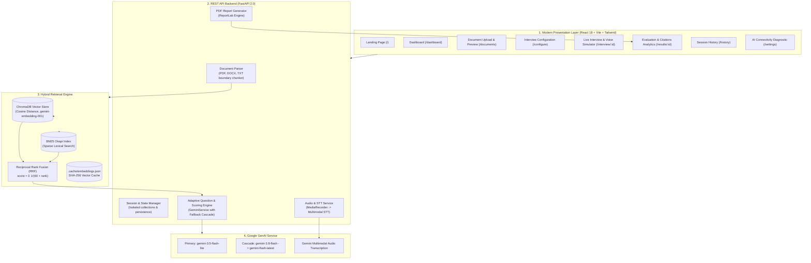

# 🎯 InterviewIQ: Production AI-Powered Mock Interview Platform

[](https://fastapi.tiangolo.com/)
[](https://react.dev/)
[](https://www.typescriptlang.org/)
[](https://vitejs.dev/)
[](https://tailwindcss.com/)
[](https://www.trychroma.com/)
[](https://ai.google.dev/)
[]()

**InterviewIQ** is an enterprise-grade, full-stack AI preparation platform engineered specifically for **AI Engineers**, **Agentic Systems Architects**, and **Full-Stack Developers**.

Unlike generic interview chatbots that ask generic textbook questions, InterviewIQ dynamically anchors its interview questions in the intersection between a candidate's actual resume projects and the explicit architectural requirements of the target job description. The system adaptively recalibrates question difficulty based on candidate performance, simulates real-time voice answers via microphone recording, transcribes speech with Gemini Multimodal Audio, and generates downloadable PDF evaluation reports.

---

## 🏛️ System Architecture



---

## 🚀 Key Platform Features

1. **Precision Boundary Chunking (`app/ingest.py`)**:
   - Replaces naive character slicing with sentence (`(?<=[.!?])\s+`) and paragraph boundary chunking.
   - Preserves complete architectural thoughts and supports **PDF**, **DOCX**, and **TXT** files.
2. **Hybrid Search with Reciprocal Rank Fusion (RRF)**:
   - Fuses dense semantic vectors (`gemini-embedding-001`, 3072-dim) with sparse Okapi BM25 keyword matching.
   - Accurately captures both high-level semantic abstractions and exact library names (e.g. `LangGraph`, `FastAPI`, `AST`).
3. **Resilient Gemini Service with Model Cascading (`app/services/gemini_service.py`)**:
   - Automatic model fallback cascade: `gemini-3.5-flash-lite` $\rightarrow$ `gemini-3.8-flash` $\rightarrow$ `gemini-flash-latest`.
   - Granular exception categorization (Auth, Quota 429, Availability 503, Timeouts) with bounded exponential backoff.
   - Built-in live connectivity diagnostics testing model latency.
4. **Live Microphone Recording & Speech-to-Text (`app/services/audio_service.py`)**:
   - Browser-native `MediaRecorder` API with waveform pulsing, duration timer, pause/resume, and audio playback.
   - Fast, verbatim audio transcription using Gemini Multimodal Audio.
   - Editable transcript box allowing candidates to review and correct transcripts before scoring.
5. **Dynamic Adaptive Question Loop (`app/generator.py`)**:
   - **Score $\ge 8$**: Advances difficulty (Easy $\rightarrow$ Medium $\rightarrow$ Hard) to test edge cases and system trade-offs.
   - **Score $\le 4$**: Automatically steps down difficulty and generates a follow-up on the **exact weak topic** to verify fundamentals.
6. **Detailed Evaluation Rubrics & Citations**:
   - Scores candidate answers from 1-10 across Relevance, Technical Correctness, Completeness, and Clarity.
   - Highlights explicit strengths, missing points, and provides a 10/10 model answer.
   - Shows grounding citations with exact page numbers and document source.
7. **Downloadable PDF Performance Reports (`app/services/report_service.py`)**:
   - Generates comprehensive PDF reports summarizing performance metrics, skill gaps, question breakdown, and model answers.
8. **Session Isolation & Private Storage (`app/services/session_store.py`)**:
   - Guarantees per-interview ChromaDB collection isolation so candidate documents never cross-contaminate.
   - Stores audio recordings securely in private local directories (`storage/recordings/`).

---

## 🛠️ Complete Tech Stack

| Layer | Component | Version | Description |
| :--- | :--- | :--- | :--- |
| **Frontend** | React.js | 18.3.1 | Component-based modern UI |
| **Frontend Tooling** | Vite | 8.3.8 | Ultra-fast HMR and bundle compilation |
| **Styling** | Tailwind CSS | 4.0.0 | Premium dark navy & violet SaaS styling |
| **Icons & Charts** | Lucide React & Recharts | 1.16.0 & 2.15.1 | Iconography and performance analytics charts |
| **Language** | TypeScript & Python 3.12 | 5.8 & 3.12.10 | Type safety across client and server |
| **Backend REST API**| FastAPI & Uvicorn | 0.163.1 & 0.54.0 | Asynchronous OpenAPI endpoints with CORS |
| **LLM & Audio STT** | Google GenAI SDK | 2.34.0 | Gemini 3.5 Flash Lite + Multimodal Audio STT |
| **Vector DB** | ChromaDB | 1.5.9 | Local in-memory cosine vector store |
| **Lexical Search** | Rank-BM25 | 0.2.2 | Okapi BM25 keyword search |
| **Document Parsers**| PyPDF & python-docx | 6.21.4 & 1.2.0 | Native PDF, DOCX, and text extraction |
| **PDF Generation** | ReportLab | 5.1.0 | Automated downloadable interview evaluation PDF reports |
| **Testing** | Pytest & HTTPX | 9.2.0 & 0.28.1 | 26 unit and integration test assertions |

---

## 💻 Local Setup Instructions

### 1. Backend Setup

Ensure Python 3.12 is installed:

```powershell
# Activate virtual environment
.\venv\Scripts\Activate.ps1

# Install curated dependencies
python -m pip install -r requirements.txt
```

Create your `.env` file in the project root:

```env
GEMINI_API_KEY=your_gemini_api_key_here
GEMINI_MODEL=gemini-3.5-flash-lite
GEMINI_FALLBACK_MODELS=gemini-3.8-flash,gemini-flash-latest
EMBED_MODEL=gemini-embedding-001
```

Launch the FastAPI REST server:

```powershell
.\venv\Scripts\python.exe -m uvicorn app.main:app --reload --port 8000
```

- Interactive Swagger API Documentation: [http://localhost:8000/docs](http://localhost:8000/docs)
- API Health Status: [http://localhost:8000/api/v1/health](http://localhost:8000/api/v1/health)
- AI Connectivity Diagnostic: [http://localhost:8000/api/v1/health/ai?test_call=true](http://localhost:8000/api/v1/health/ai?test_call=true)

### 2. Frontend Setup

In a separate terminal window:

```powershell
cd frontend
npm install
npm run dev
```

Open your browser at [http://localhost:5173](http://localhost:5173).

---

## 🧪 Testing & Verification

Run the full automated test suite (26 unit and integration tests):

```powershell
.\venv\Scripts\python.exe -m pytest -v
```

Test coverage includes:
- GeminiService authentication, 503 fallback cascading, and Pydantic structured generation
- Document boundary chunking, PDF, DOCX, and TXT parsing, and content validation
- RAG session isolation, ChromaDB vector search, BM25 keyword matching, and RRF fusion
- Adaptive difficulty progression logic ($\ge 8 \rightarrow$ advance, $\le 4 \rightarrow$ topic reinforcement)
- Speech-to-text audio upload and transcription endpoints
- Complete interview session lifecycle: creation $\rightarrow$ next question $\rightarrow$ answer scoring $\rightarrow$ completion $\rightarrow$ PDF report

---

## 🔄 Differences from the Original Version

| Feature | Original Legacy Version | Upgraded Platform (Current) |
| :--- | :--- | :--- |
| **Frontend** | Streamlit-only single-page UI | Decoupled React 18 + Vite + Tailwind SaaS application (8 pages) |
| **Document Support** | PDF and TXT only | PDF, DOCX, and TXT with structured previews |
| **State & Concurrency** | Global in-memory retriever (cross-user collisions) | Session-isolated retrievers and persistent SQLite/JSON session store |
| **Gemini Integration** | Single model call; hung indefinitely on 503 errors | `GeminiService` with automatic model fallback cascade and live diagnostics |
| **Voice Simulation** | None (text-only typing) | Full browser MediaRecorder audio recording + Gemini speech-to-text |
| **Report Export** | On-screen metric display | Downloadable multi-page PDF evaluation report |
| **REST API** | 4 basic endpoints | 14 versioned `/api/v1/` endpoints with CORS and file uploads |
| **Test Suite** | 9 unit tests | 26 comprehensive unit and integration tests |
| **Legacy Interface** | Main interface | Preserved intact at `streamlit_app.py` for fallback continuity |

---

## 📄 License
MIT License. Developed for technical interview candidates and AI Engineer portfolio demonstration.
