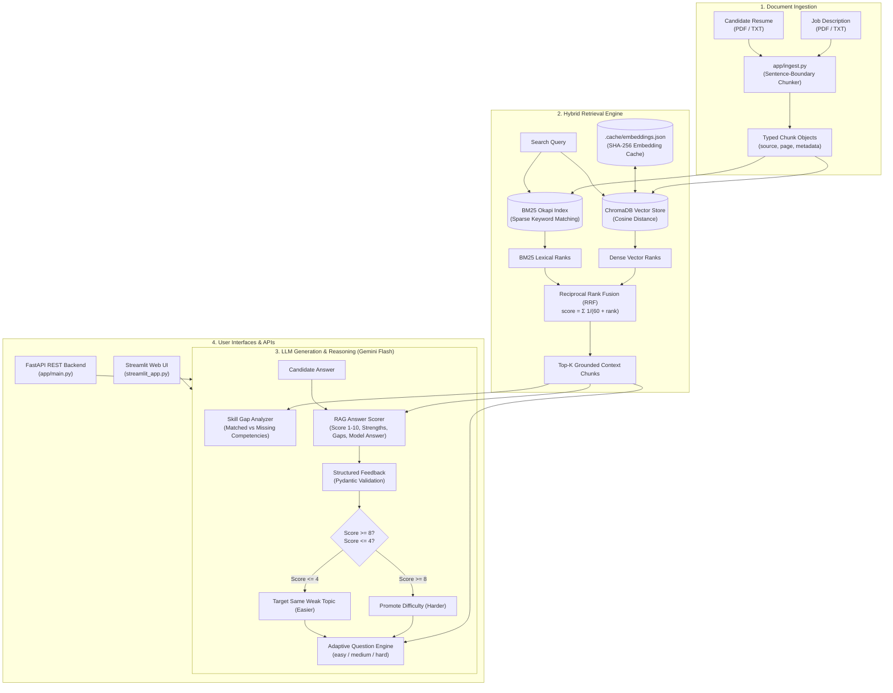

# 🎯 InterviewIQ: Adaptive RAG Interview-Prep Engine for AI Engineers

[](https://www.python.org/)
[](https://fastapi.tiangolo.com/)
[](https://streamlit.io/)
[](https://www.trychroma.com/)
[](https://ai.google.dev/)
[]()

**InterviewIQ** is a production-grade, Retrieval-Augmented Generation (RAG) platform designed to simulate high-stakes technical interviews for **AI Engineer** and **Agentic Systems** roles.

Unlike generic mock interview apps, InterviewIQ grounds its interview loop in the intersection between a candidate's actual resume projects and the explicit architectural requirements of the target job description. The system adaptively recalibrates question difficulty and topic focus based on candidate performance.

---

## 🏛️ System Architecture



---

## 🚀 Key Features

1. **Precision Sentence & Paragraph Boundary Chunking**: Eliminates naive character slicing. Chunks respect grammatical terminators (`(?<=[.!?])\s+`) and paragraph breaks, preserving full architectural thoughts.
2. **Hybrid Search with Reciprocal Rank Fusion (RRF)**: Merges dense semantic vectors (`gemini-embedding-001`) with sparse lexical tokens (`rank-bm25`) without needing arbitrary score scaling.
3. **89x Faster Repeat Indexing via Embedding Cache**: Persistent local cache (`.cache/embeddings.json`) keyed by SHA-256 hashes avoids re-embedding unchanged documents.
4. **Anti-Hallucination Guardrails**: Detects weak retrieval confidence and outputs `"Information not found in the documents."` instead of fabricating answers.
5. **Dynamic Adaptive Interview Loop**:
   - **Score $\ge 8$**: Automatically advances difficulty level.
   - **Score $\le 4$**: Automatically drops difficulty and generates a foundational follow-up on the **exact weak topic** identified.
6. **Production Dual Delivery**: Run either as an interactive, visual dashboard (**Streamlit**) or as a containerized microservice (**FastAPI**).

---

## 📊 Empirical RAG Evaluation Benchmark

Evaluated across **32 hand-crafted ground truth queries** in [`eval/test_set.json`](file:///C:/Users/Dell/Desktop/Interviewiq/eval/test_set.json) testing specific technical facts, architecture requirements, and project metrics.

| Retrieval Strategy | Hit Rate @ 1 | Hit Rate @ 3 | Hit Rate @ 5 | Mean Reciprocal Rank (MRR) | LLM Judge Quality (1-5) |
| :--- | :---: | :---: | :---: | :---: | :---: |
| **Vector-Only** (`gemini-embedding-001`) | `84.4%` | `100.0%` | `100.0%` | `0.906` | — |
| **BM25-Only** (Lexical Search) | `84.4%` | `96.9%` | `100.0%` | `0.914` | — |
| **Hybrid RRF** (800-char chunks) | **`87.5%`** | **`100.0%`** | **`100.0%`** | **`0.938`** | **`5.0 / 5.0`** |
| **Hybrid RRF** (400-char chunks) | **`90.6%`** | **`100.0%`** | **`100.0%`** | **`0.953`** | **`5.0 / 5.0`** |

Full benchmark report generated at [`eval/results.md`](file:///C:/Users/Dell/Desktop/Interviewiq/eval/results.md).

---

## 🛠️ Tech Stack

| Category | Component / Library | Purpose |
| :--- | :--- | :--- |
| **Language** | Python 3.12 | Core backend language |
| **LLM & Embeddings** | `google-genai` (Gemini Flash & `gemini-embedding-001`) | Fast, cost-effective structured JSON generation & embeddings |
| **Vector DB** | `chromadb` (1.5.9) | In-memory cosine similarity vector index |
| **Keyword Search** | `rank-bm25` (0.2.2) | Sparse Okapi BM25 keyword search |
| **Web UI** | `streamlit` (1.66.1) | Interactive interview dashboard with session progress charts |
| **REST API** | `fastapi` (0.163.1) & `uvicorn` (0.54.0) | High-performance OpenAPI REST endpoints |
| **Document Processing**| `pypdf` (6.21.4) | Native PDF stream extraction |
| **Validation** | `pydantic` (2.14.1) | Strongly typed data models and bounds validation |
| **Testing** | `pytest` (9.2.0) | Unit testing suite for ingestion and schema constraints |
| **Containerization** | Docker & Docker Compose | Production container packaging |

---

## 💻 Run Instructions (Windows PowerShell)

### 1. Prerequisites & Environment Setup
Clone the repository and ensure Python 3.12 is installed:

```powershell
# Create and activate virtual environment
python -m venv venv
.\venv\Scripts\Activate.ps1

# Install curated dependencies
python -m pip install -r requirements.txt
```

Create your `.env` file in the project root:
```env
GEMINI_API_KEY=your_gemini_api_key_here
```

### 2. Launch the Streamlit Interactive UI
```powershell
.\venv\Scripts\streamlit.exe run streamlit_app.py
```
Open [http://localhost:8501](http://localhost:8501) in your browser. Click **"Analyze & Build Retriever"** to load the bundled sample data, review your skill gap map, and start the adaptive mock interview.

### 3. Launch the FastAPI Backend
```powershell
.\venv\Scripts\python.exe -m uvicorn app.main:app --reload --port 8000
```
- Interactive Swagger UI: [http://localhost:8000/docs](http://localhost:8000/docs)
- Health Check: `GET http://localhost:8000/health`
- Endpoints: `POST /analyze`, `POST /question`, `POST /score`

### 4. Run the Evaluation Suite
```powershell
.\venv\Scripts\python.exe eval\run_eval.py
```

### 5. Run Unit Tests
```powershell
.\venv\Scripts\python.exe -m pytest -v
```

---

## 🧠 Architectural Design Decisions

### 1. API-Based Embeddings vs. Local PyTorch Models
- **Decision**: Used Google Gemini API (`gemini-embedding-001`) instead of local `sentence-transformers` or `torch`.
- **Reasoning**: Many enterprise and educational environments enforce Windows Application Control (AppLocker/WDAC) that blocks PyTorch's native DLLs (`c10.dll`). API embeddings eliminate GPU dependencies, reduce Docker image size from ~4 GB down to ~300 MB, and provide SOTA 768-dimensional semantic embeddings with zero local compute overhead.

### 2. Why Hybrid Search (Vector + BM25) with Reciprocal Rank Fusion?
- **Dense Vector Search** understands synonyms and conceptual phrasing (e.g. mapping "agent loops" to "cyclic workflows"), but often struggles with exact library names or short acronyms.
- **BM25 Search** excels at exact term frequencies (e.g. "AST", "Copilot Studio", "500+ users").
- **Reciprocal Rank Fusion (RRF)**: Rank-based formula $RRF(d) = \sum \frac{1}{60 + \text{rank}(d)}$ combines both lists without requiring calibrating disparate score distributions (cosine distance vs unbounded BM25 scores).

### 3. Structured Outputs with Pydantic
- Utilizing Gemini's `response_schema` directly in the API call guarantees that the model returns valid JSON matching our Pydantic classes (`Feedback`, `Question`, `SkillGap`), eliminating json parsing failures.

---

## ⚠️ Limitations & Future Work

1. **Multi-Tenant State Management**: Current API uses in-memory session retrievers. Production roadmap includes persistent ChromaDB cloud clustering and Redis session stores.
2. **Multi-Modal Document Parsing**: Current ingestion extracts text using `pypdf`. Future work will add OCR (Tesseract / Gemini Vision) for scanned resumes and diagram-heavy portfolios.
3. **Voice Audio Simulator**: Integrating Gemini Multimodal Live API via WebSockets for real-time conversational voice interviews with realistic interruptions.

---

## 📄 License
MIT License. Developed for technical interview candidates and AI Engineer portfolio demonstration.
